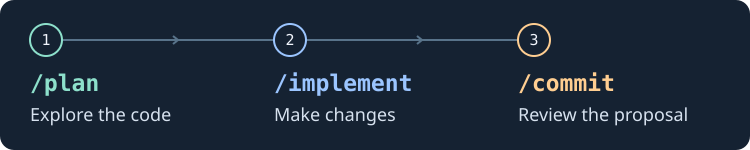

# pi-enhanced

An extension suite for the [Pi coding agent](https://github.com/earendil-works/pi). Choose a model, explore a change in read-only mode, then review the diff before committing—all from the same terminal session.



## Quick start

With Pi installed, run this in your terminal:

```bash
pi install git:github.com/RaviEdho/pi-enhanced
pi
```

In Pi, keep your current model or use `/login` to connect a provider and `/model` to pick a model. Try a read-only task first:

```text
/plan Trace how this project handles configuration. Which file would I change to add a setting?
```

When you’re ready to make changes, use `/implement` with your instructions. Afterward, `/commit` proposes a commit you can edit, approve, or cancel.

## What else can I do?

| Task | Where to start |
| --- | --- |
| Check account limits | `/usage` shows quotas, reset times, or balances where the provider reports them. |
| See what’s filling the context window | `/context` breaks down messages, tool output, and remaining space. |
| Search without flooding the chat | Ask Pi to find a symbol or search the web. Terminal output is condensed; `/recall <id>` retrieves the original. |
| Delegate a side task | `/subagent` starts an isolated task; `/jobs` shows background work. |
| Work from chat | See the [Discord](docs/discord.md) and [WhatsApp](docs/whatsapp.md) gateway guides. Only allow people you trust with your local files and shell. |
| Tune the extension | `/settings-enhanced` controls search, compression, session titles, telemetry, and more. |

## Guides

- **[Providers and accounts](docs/providers.md)** — Sign-in, model selection, billing caveats, and failover for Google Antigravity, Command Code, Kenari, Token Harbor, InferHub (experimental), Ollama Cloud, OpenCode Go, and OpenAI Codex.
- **[Terminal workflows and settings](docs/workflows.md)** — Plan mode, selective commits, pull requests, web search keys, and the settings reference.
- **[Discord gateway](docs/discord.md)** — Bot permissions, shared threads, file uploads, schedules, and running the gateway at boot.
- **[WhatsApp gateway](docs/whatsapp.md)** — Experimental QR pairing and allowlisted private text DMs with saved Pi conversations.

## Development

From a checkout, run `npm run typecheck` to check TypeScript or `pi -e ./index.ts` to try the extension without installing it. See [UPSTREAM.md](UPSTREAM.md) for the origins of Scout search and the output compressor.
